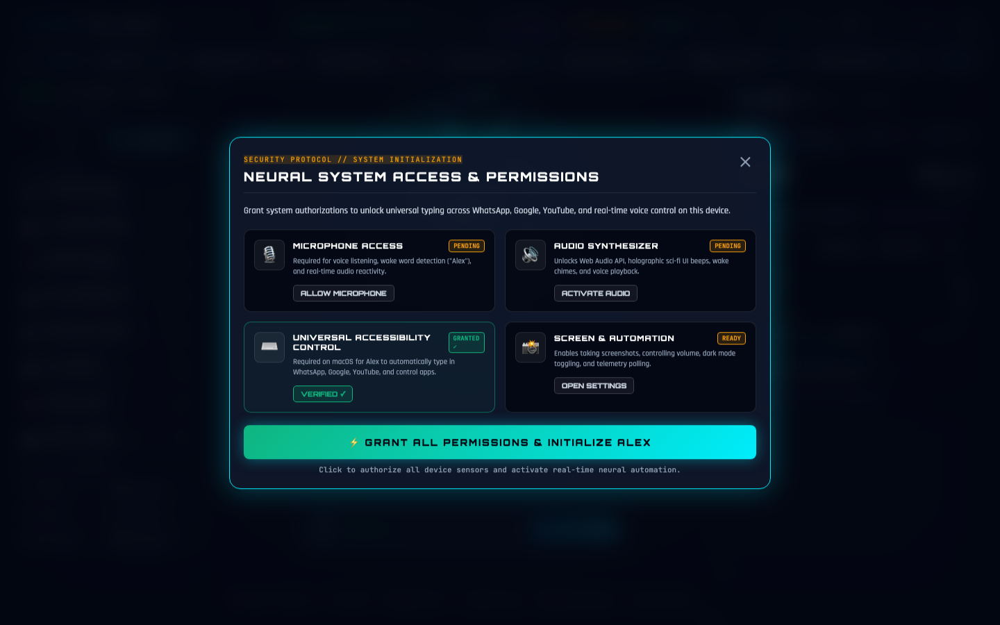
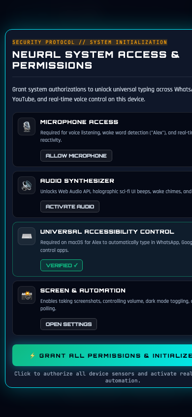

# ⚡ ALEX AI — Autonomous Neural Intelligence Cockpit

[](https://named-here-hold-garlic.trycloudflare.com)
[](https://github.com/nikithpadmanabhuni/alex-ai.git)
[](https://www.python.org/)

**Alex AI** is a production-grade autonomous cognitive assistant and futuristic Cyberpunk Cockpit. It operates simultaneously across laptops, desktops, and mobile smartphones worldwide with real-time bidirectional voice interaction, live stock market telemetry, and the **OmniBrain Universal Intelligence Engine** capable of answering any question in the world.

---

## 🌐 Live Access Links

- **🌍 Global Public HTTPS Website:** [https://named-here-hold-garlic.trycloudflare.com](https://named-here-hold-garlic.trycloudflare.com)
- **💻 Local Machine Cockpit:** [http://127.0.0.1:5005](http://127.0.0.1:5005)
- **📱 Local Wi-Fi Network:** [http://192.168.0.121:5005](http://192.168.0.121:5005)
- **📦 GitHub Repository:** [https://github.com/nikithpadmanabhuni/alex-ai.git](https://github.com/nikithpadmanabhuni/alex-ai.git)

---

## 📸 Interface Showcase

| Desktop Interface (1440x900 Cockpit) | Mobile Adaptive View (iPhone / Android) |
| :---: | :---: |
|  |  |

---

## 🧠 OmniBrain: Universal World Knowledge Engine

Alex is equipped with the multi-tier **OmniBrain Universal Knowledge Engine**, which answers any question in the world without requiring external browser popups:

1. **Physical Sciences & Astronomy:** Speed of light, gravitational constants, quantum mechanics, distances to Moon/Sun, age of universe, black holes.
2. **World Geography & Atlas:** Capitals of all 60+ countries, deepest ocean trenches, highest mountain peaks, longest rivers, largest deserts.
3. **Lexicon & Etymology:** Full definitions, parts of speech, and pronunciations via integrated lexical engines (`"define serendipity"`).
4. **Global Real-Time Weather:** Live weather for any city on Earth (`"weather in Tokyo"`, `"weather in London"`).
5. **Advanced Mathematics & Unit Conversions:** Scientific trigonometric functions (`sin`, `cos`, `tan`), square roots, exponents, factorials, percentages, and conversions (miles $\leftrightarrow$ km, Fahrenheit $\leftrightarrow$ Celsius, lbs $\leftrightarrow$ kg, GB $\leftrightarrow$ MB).
6. **Wikipedia OpenSearch & Entity Synthesizer:** Real-time factual summaries across millions of global historical, scientific, technological, and cultural topics.
7. **Interactive Knowledge Cards:** Every factual response generates a glowing Cyberpunk Knowledge Card in the live cockpit feed.

---

## 📈 Corporate & Live Stock Market Intelligence

- **Live Tickers:** Real-time pricing, percentage change, and gradient charts for major equities (**NVDA**, **AAPL**, **MSFT**, **TSLA**, **GOOGL**, **AMZN**).
- **Fundamental Analysis:** Executive leadership (CEO), Market Cap, P/E Ratio, EPS, Beta, 52-Week Range meter, and live corporate news briefs.
- **Voice Queries:** Ask *"show details of companies and all"*, *"details of Apple"*, or *"who is the CEO of Nvidia"*.

---

## 🎙️ Cross-Browser Voice Pipeline

- **Primary Pipeline:** Web Speech API on Chrome, Edge, Safari, Android Chrome, and iOS Safari.
- **Universal Fallback:** HTML5 `MediaRecorder` audio uploads to `/api/voice_upload` (converted on the server to 16kHz mono PCM WAV and transcribed via Google Speech API) for browsers lacking native speech APIs.
- **Zero Audio Echo:** Single-stream audio playback via `/api/tts_audio` with deduplication window and `speak_on_server = False` for web clients.

---

## 🚀 Quickstart & Local Setup

```bash
# 1. Clone repository
git clone https://github.com/nikithpadmanabhuni/alex-ai.git
cd alex-ai

# 2. Setup virtual environment & dependencies
python3 -m venv .venv
source .venv/bin/activate
pip install -r requirements.txt

# 3. Launch Alex Cockpit
python alex.py
```

Open your browser at `http://127.0.0.1:5005` or access the generated Cloudflare HTTPS URL from any mobile phone worldwide.

---

## 📄 License & Attribution

Developed by **Nikith Padmanabhuni** • Powered by Alex AI Neural Architecture.
